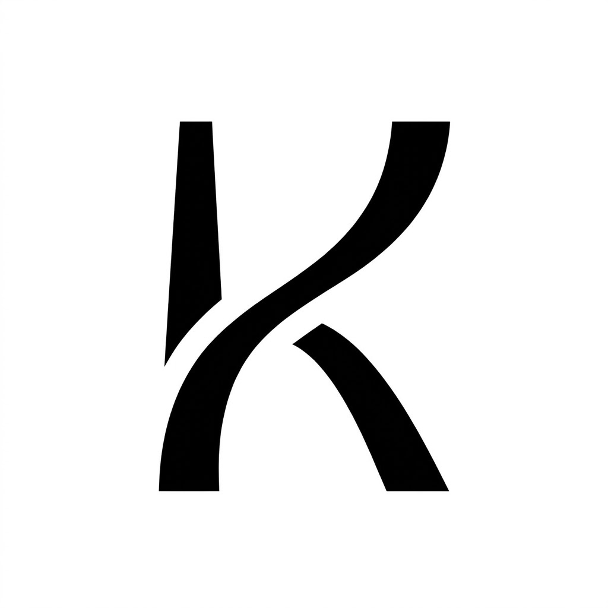

<div align="center">
  <br />
  <picture>
    <source media="(prefers-color-scheme: dark)" srcset="./assets/brand/深色logo.jpeg" />
    <source media="(prefers-color-scheme: light)" srcset="./assets/brand/浅色logo.jpeg" />
    
  </picture>

  <h1>KANON · 卡农</h1>

  <p><strong>Conviction, composed.</strong><br />在噪音里，谱出自己的确定性。</p>

  <p>
    面向深度美股长期主义者的 <strong>Linear 级投资逻辑操作系统（Investment Thesis OS）</strong>。<br />
    把听来的观点，炼成自己算出来的底气。
  </p>

  <p>
    
    
    
    
    
  </p>
</div>

---

## 为什么做 KANON（卡农）

大多数金融软件在制造焦虑：跳动的红绿 K 线、嘈杂的社区喊单、替你算命的聊天机器人。

**KANON** 反其道而行之。名字取自 **Canon（第一性原理与准则）** 与 **卡农（层层递进的复调与产业链交叉印证）**——融合 **Swiss Editorial 杂志级留白** 与 **Apple Natural Titanium（原色钛金属）** 工业克制，只服务一件事：**帮你用顶级买方研究方法，把一家好公司从头到尾看透、算清赔率、守住纪律。**

> **核心克制（Non-Goals）**：不做实时盯盘终端，不做直接给买卖建议的算命聊天框，不做游戏化打卡徽章，不做社交喊单社区。

---

## 核心闭环与五大产品能力

```text
新建美股标的 ─▶ Step 1 商业模式一票否决 ─▶ Step 2 拆解 3 条可证伪核心假设
                                                    │
    一键导出 Google Doc / Sheets / 口播稿 ◀── Step 5 零杠杆交易铁律与复盘 ◀── Step 4 三情景估值赔率 ◀── Step 3 SEC 一阶资料与上下游交叉印证
```

### 1. Swiss Bento 投资驾驶舱（`/`）

- **极简三层视觉秩序**：公司身份与等宽索引编号（`01 / 02`）→ 36px 估值锚点与去噪走势曲线 → 3 条清晰核心假设状态灯（翠绿验证 / 琥珀观察 / 绯红预警）。
- **灵动交互体验**：单条假设点击即弹开证伪红线与财报佐证；点击「速览」滑出右侧弹簧抽屉；全局 **`⌘K` 命令面板** 覆盖全部标的直达、12 个高频行业术语速查、全仓 CSV 导出与深浅双模式切换。

### 2. 五步引导式研究画布（`/thesis/[id]`）

- **Step 1 · 商业模式一票否决滤镜**：从复购与水电煤属性、上下游定价权、ROIC / FCF 质量、管理层治理 4 大维度结构化打分，不通过可直接「一票否决并放弃观察」归档。
- **Step 2 · 三条可证伪核心假设 + 红队挑刺**：逼迫把听来的看多观点收敛为最多 3 条带量化阈值的假设；内置 **「红队挑刺（Devil's Advocate）」** 强制切换苛刻空头视角输出 3 条致命证伪路径。
- **Step 3 · 一阶资料交叉验证 + SEC EDGAR 同步 + 电话会提炼**：直连官方免费 **SEC EDGAR API** 拉取 10-K / 10-Q 披露原文与 XBRL 财务事实并缓存入 Postgres（绝不让大模型编造数字）；支持产业链上下游并排对照（如 `美光 ↔ 英伟达 / 海力士 / 台积电`）与 **「提炼电话会」**。
- **Step 4 · 交互式三情景估值赔率计算器**：基于 HeroUI v3 精密滑块实时调整悲观 / 中性 / 乐观 2–5 年后 `EPS` 与 `PE`，由 `@kanon/core` 纯函数零延迟计算目标价、年化 CAGR、下行风险、赔率比（Upside / Downside）与概率加权期望值。
- **Step 5 · 零杠杆交易铁律检查单 + 一键转口播大纲**：建仓 / 加仓 / 持有操作在**领域层 Schema 与前端硬开关双层锁死「零杠杆原则」**；记录当下情绪与认错红线，并可一键将整份 5 步研究提炼为高质感视频口播脚本。

### 3. 内联行业术语卡片（Inline Glossary Popover）

- 画布中出现 `HBM3E`、`CoWoS`、`NVLink`、`CapEx`、`ROIC`、`FCF`、`PE`、`CAGR`、`EV/EBITDA`、`10-K`、`Moat` 等专业术语时自动虚线标注，点击即时弹出白话释义、美股财报口径与实战案例，不打断思考心流。

### 4. 一键导出与外部工作流同步

- **Google Docs 研报**：`/api/export/thesis/[id]?format=gdoc` 导出排版精良的语义 HTML，拖入 Google Drive 即可无损转换为 Google Doc。
- **Markdown 档案**：`/api/export/thesis/[id]?format=md` 导出纯净 Markdown 深度备忘录。
- **Google Sheets 全仓赔率表**：`/api/export/portfolio` 导出带 UTF-8 BOM 的 RFC-4180 CSV 台账，覆盖三情景目标价、CAGR 与赔率比。

---

## 设计系统（Swiss Editorial × Apple Natural Titanium）

封装于 [`packages/ui`](packages/ui)（**HeroUI v3** + Tailwind CSS v4 + Framer Motion + Recharts + Tabler Icons），所有业务页面严禁绕过 `@kanon/ui`：

| 维度                | Light（暖白纸面）                          | Dark（阳极黑曜石）             | 机械门禁                                  |
| :------------------ | :----------------------------------------- | :----------------------------- | :---------------------------------------- |
| **画布 / 卡片**     | `#F7F7F5` / `#FFFFFF`                      | `#0B0C0E` / `#141518`          | 零硬编码 Hex / 原始色板                   |
| **品牌钛金属色**    | `#E5E3DD`（Natural Titanium）              | `#272622`（Anodized Titanium） | 统一映射 HeroUI v3 `@layer theme`         |
| **主墨色 / 强调色** | `#111113` / 暖珊瑚橙 `#EA6B4A`             | `#F4F4F2` / `#EA6B4A`          | 90% 中性克制，唯一焦距高亮                |
| **排版与数字**      | `Geist` + `PingFang SC` / `JetBrains Mono` | 同左                           | `tabular-nums` + **最小 12px 字号硬下限** |
| **动效与图标**      | `KANON_SPRING (420, 34, 0.8)`              | 同左                           | 禁用弹跳动画；Tabler 强制 `stroke={1.5}`  |

---

## Monorepo 架构与 AI-Native 四层机械门禁

本项目严格遵循 **AI-Native 代码库园艺（Trust Pyramid）** 工程实践——**能用代码硬性拦截的，绝不靠文档提醒**：

```text
kanon/
├── apps/web/                   # Next.js 16 App Router + React 19 + Tailwind CSS v4
│   └── src/
│       ├── app/                # 薄 Server Component 路由 + REST API（唯一允许访问 DB 层）
│       └── features/           # 垂直领域切片：thesis/ | valuation/ | journal/ | glossary/
├── packages/
│   ├── ui/                     # HeroUI v3 + KANON Natural Titanium 封装层（零业务依赖）
│   ├── core/                   # Drizzle Postgres Schema + PGlite/Postgres 客户端 + 纯估值数学 + 导出器
│   └── ai/                     # SEC EDGAR 客户端 + Vercel AI SDK BYOK + Zod 结构化副驾驶
├── scripts/
│   └── check-design-and-limits.mjs  # TypeScript AST 物理尺寸、审美与色值机械门禁
├── .agents/skills/             # 内置 HeroUI v3 官方 Agent Skills（heroui-react / heroui-theming）
└── .rules/postmortems.md       # Mistake-to-Rule 错题升级沉淀库
```

### 四层门禁（单一真源：`pnpm check && pnpm test && pnpm build`）

| 层级                        | 执行命令                               | 机械拦截内容                                                                                                                                                                                    |
| :-------------------------- | :------------------------------------- | :---------------------------------------------------------------------------------------------------------------------------------------------------------------------------------------------- |
| **L1 静态与严格类型**       | `pnpm lint` + `pnpm typecheck`         | Biome 严格模式（零 `any`、零 `console.*`、圈复杂度 ≤ 12）+ 全仓 4 包 `tsc --noEmit`                                                                                                             |
| **L2 架构与审美 AST 门禁**  | `pnpm depcruise` + `pnpm design:check` | 模块边界与 Server-only DB 隔离 + AST 强制：单文件 ≤ 250 行、单函数 ≤ 50 行、嵌套 ≤ 3 层、零类型逃生舱（`as any` / `as never` / `as unknown as`）、零硬编码色值、最小字号 ≥ 12px、`stroke={1.5}` |
| **L3 领域不变量与集成测试** | `pnpm test`                            | 估值赔率纯函数单测 + 内存真实 PostgreSQL（PGlite）CRUD 与 **7 表 DDL / Schema 列级 1:1 一致性校验** + 零杠杆铁律硬拦截测试 + 导出器与 SEC/AI Zod 契约测试                                       |
| **L4 Git 钩子与 CI 卡点**   | `lefthook.yml` + GitHub Actions        | Pre-commit 自动拦截 + PR 流水线强制全绿                                                                                                                                                         |

---

## 快速启动（零配置开箱即用）

> **零外部依赖开箱体验**：未配置 `DATABASE_URL` 时，KANON 会自动启动本地磁盘持久化的嵌入式真实 PostgreSQL（`@electric-sql/pglite`，数据落盘于 `.data/kanon-pg`），并自动建表写入 `MU（美光科技）`、`NVDA（英伟达）` 完整 5 步研究样板与 12 个核心术语。

```bash
# 1. 安装依赖（Node >= 22, pnpm >= 10）
pnpm install

# 2. 启动本地开发环境（默认 http://localhost:3000）
pnpm dev
```

### 可选：连接云端 PostgreSQL（Neon / Supabase）与 BYOK 大模型

复制 `.env.example` 为 `.env.local` 按需配置：

```bash
cp .env.example .env.local
```

- 填入 `DATABASE_URL` 后运行 `pnpm db:push` 即可无缝切换至 Neon / Supabase 生产 PostgreSQL。
- 填入 `GEMINI_API_KEY`、`ANTHROPIC_API_KEY` 或 `OPENAI_API_KEY` 任意其一，即可激活 **Vercel AI SDK** 实时大模型推理（未配置时自动使用基于真实入库数据与 SEC 缓存的确定性结构化引擎，同样严格经过 Zod 校验）。

### 常用研发与验证命令

```bash
pnpm check        # 运行 L1+L2 全部机械门禁（Biome + TS + depcruise + AST 审美/尺寸门禁）
pnpm test         # 运行 L3 全部 Vitest 单元测试与 Postgres DDL 一致性集成测试
pnpm build        # 运行 Turborepo 全仓生产构建
pnpm format       # Biome 一键自动格式化
```

---

<div align="center">
  <sub>KANON · 卡农 — <em>Quiet precision for long-term minds.</em></sub>
</div>
