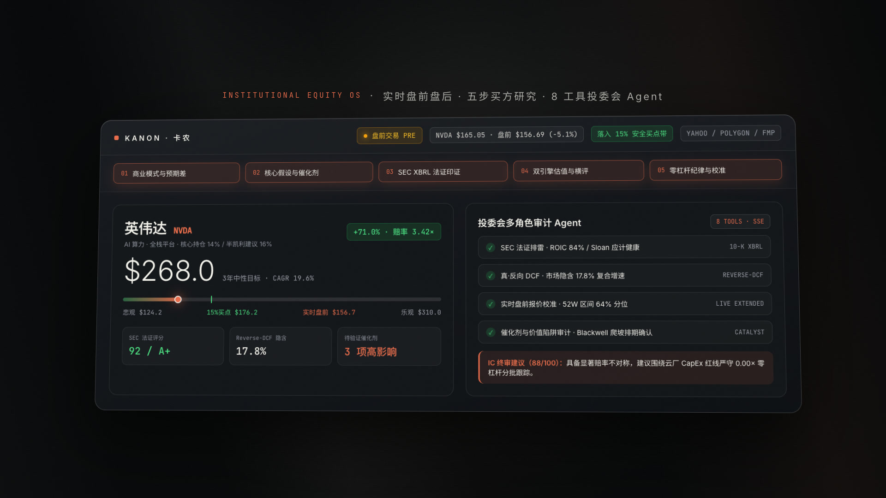
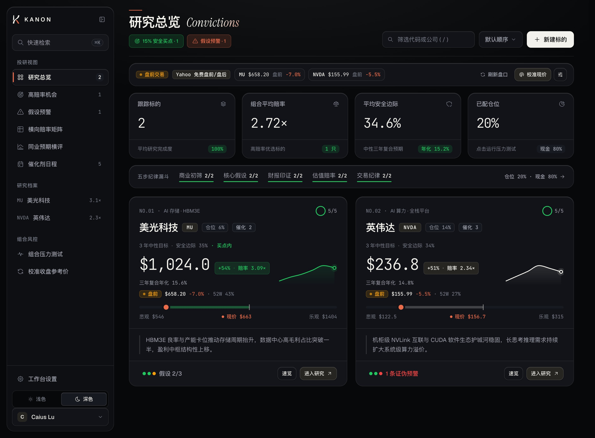
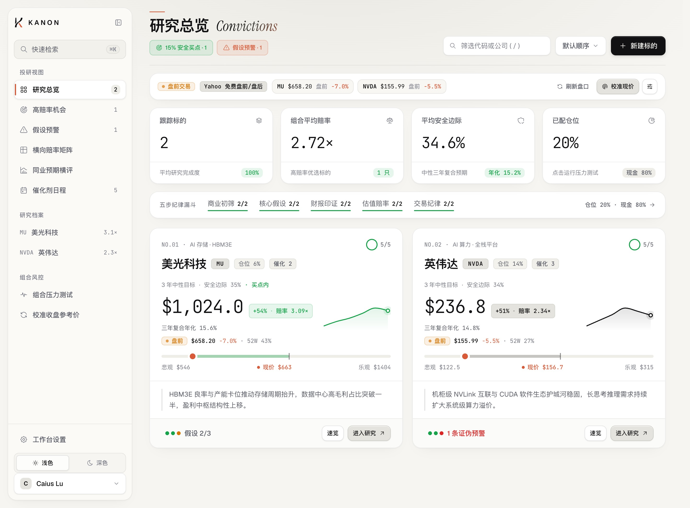
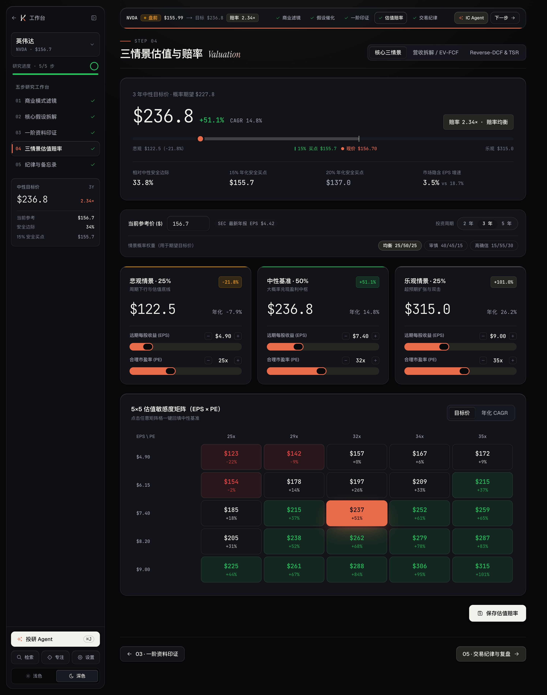
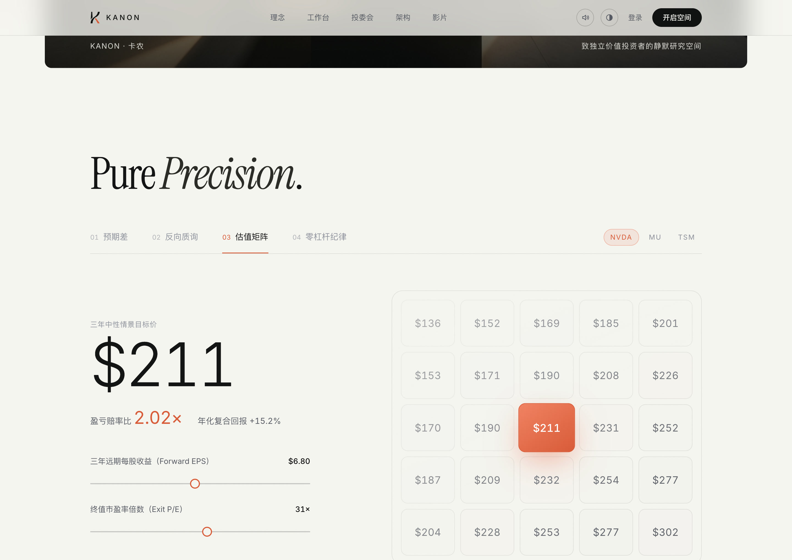
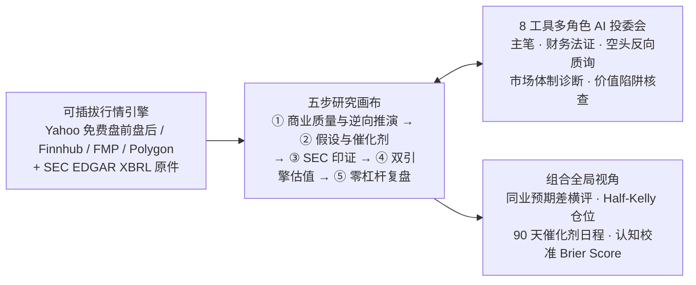

<div align="center">
  <br />
  <a href="https://kanon.hk">
    
  </a>

  <h1>KANON · 卡农</h1>

  <p>
    <strong>Conviction, composed.</strong><br />
    在噪音里，谱出自己的确定性。
  </p>

  <p>
    面向顶级个人价值投资者与买方投研机构的 <strong>投资逻辑操作系统（Investment Thesis OS）</strong>。<br />
    剥离跳动 K 线与算命式聊天框——以可插拔实时盘前/盘后行情、SEC XBRL 一阶溯源、8 工具多角色 AI 投委会、<br />
    双引擎估值赔率矩阵与零杠杆认知校准闭环，把听来的观点，炼成自己算出来的底气。
  </p>

  <p>
    <a href="https://kanon.hk"><strong>官网 kanon.hk ↗</strong></a>
    &nbsp;&nbsp;·&nbsp;&nbsp;
    <a href="https://app.kanon.hk"><strong>工作台 app.kanon.hk ↗</strong></a>
    &nbsp;&nbsp;·&nbsp;&nbsp;
    <a href="https://kanon.hk/#film"><strong>观看 26s 品牌影片 ▶</strong></a>
    &nbsp;&nbsp;·&nbsp;&nbsp;
    <a href="./docs/PRD.md">产品白皮书 PRD</a>
    &nbsp;&nbsp;·&nbsp;&nbsp;
    <a href="./docs/PRODUCT_ARCHITECTURE_V3.md">架构蓝图</a>
  </p>
  <br />

  <a href="https://kanon.hk">
    
  </a>
</div>

---

## Brand Film · 品牌宣传片（26s · 1080p · 60fps）

<div align="center">
  <a href="https://kanon.hk/#film">
    
  </a>
  <p>
    <sub>
      七幕叙事：<strong>噪音溶解 → 机械精密 → 立体买方工作台实时估值 → 四声部投委会复调 → 零杠杆地平线 → KANON 纪念碑</strong>，配以纯代码合成 48 kHz 立体声卡农原声。<br />
      <a href="https://kanon.hk/#film"><strong>在官网全屏观看（含立体声原声）↗</strong></a>
      &nbsp;&nbsp;·&nbsp;&nbsp;
      <a href="./marketing/assets/kanon-brand-film.mp4">仓库原片 <code>kanon-brand-film.mp4</code></a>
      &nbsp;&nbsp;·&nbsp;&nbsp;
      <a href="./promo-video/">纯代码片源与合成器</a>
    </sub>
  </p>
</div>

---

## Pure Precision · 界面与实景工作台

融合 **Swiss Editorial 建筑留白**、**BoardUI 仪表盘骨架** 与 **HeroUI v3 语义交互**——全站保持 95% 极简黑白灰（Obsidian Titanium 深色 / Warm Swiss Paper 浅色）与单点珊瑚红焦点，严格执行 6 级同心圆角几何系统（`20px / 14px / 10px / 8px / 6px / 9999px`）、零重型图表首屏纯 SVG 样条曲线与零冗余文案克制。

<table>
  <tr>
    <td width="50%" valign="top">
      
      <p align="center"><sub><strong>深色钛金工作台（Obsidian Titanium）</strong><br />实时盘前/盘中/盘后行情条 · 赔率与安全边际 Bento 卡 · 52W 区间轨 · 催化剂/横评导航</sub></p>
    </td>
    <td width="50%" valign="top">
      
      <p align="center"><sub><strong>浅色纸质工作台（Warm Swiss Paper）</strong><br />View Transition 丝滑主题切换 · 高对比可读排版 · 零压迫感长时深度阅读</sub></p>
    </td>
  </tr>
</table>

<div align="center">
  
  <p>
    <sub>
      <strong>五步研究画布 · Step 4 估值赔率与 5×5 敏感度矩阵</strong><br />
      顶部粘性上下文进度条（实时盘前价 + 目标价 + 赔率 + 1–5 步一键直达 + IC Agent） · 三情景概率加权期望 · Reverse-DCF 市场隐含 EPS 增速反推 · 点击矩阵格一键回填中性基准
    </sub>
  </p>
</div>

<div align="center">
  <a href="https://kanon.hk/#instrument">
    
  </a>
  <p>
    <sub>
      <strong>官方品牌站 <a href="https://kanon.hk">kanon.hk</a></strong> — 建筑级光影叙事与产品核心体验预览
    </sub>
  </p>
</div>

---

## 为什么是 KANON（卡农）

绝大多数金融终端都在精密地贩卖焦虑：闪烁的红绿 K 线、嘈杂的社区喊单、替你算命的聊天机器人。

**KANON** 取义 **Canon（第一性原理与准则）** 与 **卡农（层层递进的复调交叉印证）**，对齐顶级买方机构（Bipsync / VerityRMS / Expectations Investing）的投研闭环，只专注一件事：**帮你把一家好公司看透、算清赔率、守住纪律。**

- **不做** 实时盯盘 K 线终端或券商下单通道
- **不做** 直接给出买卖建议的算命式聊天框
- **不做** 打卡徽章游戏化与社交喊单广场
- **坚持** 零杠杆硬契约（`0.00×`）、SEC 原件溯源、可证伪追踪与人类终审主权（Human-in-the-Loop）

---

## Four Voices. One Verdict. · 机构级投研框架



| 机构能力模块                 | 核心工程落地                                                                                                                                                                                               |
| :--------------------------- | :--------------------------------------------------------------------------------------------------------------------------------------------------------------------------------------------------------- |
| **五步买方研究画布**         | 四维商业质量评估（预期差 Variant Perception + 逆向压力推演 Downside Scenario）→ 核心假设与催化剂 → SEC 一阶印证 → 双引擎估值 → 零杠杆交易纪律；顶部粘性上下文进度条实时联动行情、赔率与下一步引导          |
| **可证伪假设与催化剂日程**   | 独立 `thesis_catalysts` 扩展表，结构化追踪财报 / 产品发布 / 监管 / 产能节点，记录市场一致预期、看多触发与证伪阈值；组合侧提供 90 天催化剂全局日程看板                                                      |
| **SEC XBRL 零幻觉溯源**      | 直连官方 SEC EDGAR API 拉取多年度 10-K / 10-Q 财务事实与风险因子，作为唯一可信底座，杜绝大模型凭空编造数字                                                                                                 |
| **双引擎估值与同业预期横评** | 确定性纯函数计算熊/中/牛三情景目标价、概率加权期望、3 年 CAGR、上下行赔率、Reverse-DCF 隐含增速与 **5×5 EPS × P/E 敏感度矩阵**；组合视图内置 **同业预期差矩阵与 Half-Kelly 参考仓位**                      |
| **8 工具多角色 AI 投委会**   | 基本面主笔 · 财务法证审阅 · 空头反向质询（Counter-Thesis）+ 实时盘前/盘后市场体制诊断 + 催化剂与价值陷阱核查；SSE 流式思维轨迹，所有修改以结构化提案交由人类终审采纳（BYOK 支持 Gemini / Claude / OpenAI） |
| **零杠杆约束与认知校准**     | 领域层 Schema、数据库与前端锁死 `0.00×` 杠杆；Step 5 新增 **认知校准与决策 Alpha（Brier Score）** 复盘面板；一键导出 Google Docs、Markdown 投委会备忘录与全仓赔率 CSV                                      |

---

## 可插拔实时行情架构（免费开箱 → 付费机构无缝升级）

KANON 内置统一的行情抽象层与 SWR 60 秒缓存 + 自动降级链（`Provider Registry`）。**零配置即可免费获取实时盘前 / 盘中 / 盘后报价**；需要更高速率或专业机构数据源时，可在应用内 **`设置 → 行情接口`** 或 `.env` 中一键切换至付费接口，无需修改任何业务代码。

| 数据源层级             | 行情接口                          |      盘前 / 盘后扩展时段      | 覆盖能力                                                 | 配置方式                   |
| :--------------------- | :-------------------------------- | :---------------------------: | :------------------------------------------------------- | :------------------------- |
| **免费内置（默认）**   | **Yahoo Finance (`v8/chart`)**    | **支持（PRE / REG / POST）**  | 实时主盘与盘前盘后价、涨跌幅、52W 高低轨、6 个月走势折线 | **零配置开箱即用**         |
| **免费内置（默认）**   | **SEC EDGAR XBRL**                |               —               | 官方 10-K / 10-Q 多年度财报、EPS、现金流、风险因子原文   | **零配置开箱即用**         |
| **付费可选（Tier 1）** | **Finnhub**                       |           实时报价            | 高频稳定 REST 报价 + 付费异常自动回退免费 Yahoo          | `FINNHUB_API_KEY` 或设置页 |
| **付费可选（Tier 2）** | **Financial Modeling Prep (FMP)** | **支持（Aftermarket Trade）** | 盘前/盘后成交价 + 机构级基本面与估值数据扩展             | `FMP_API_KEY` 或设置页     |
| **付费可选（Tier 3）** | **Polygon.io (SIP)**              |  **支持（全市场 SIP 快照）**  | 机构级美股合并行情快照、扩展时段逐笔数据                 | `POLYGON_API_KEY` 或设置页 |

> 设置页内置 **连通性实测（Test Connection）**，一键校验 API Key 延迟与返回源；任何付费接口限流或异常时自动平滑降级至免费 Yahoo Finance，保证研究工作台永不中断。

---

## AI-Native 零 Slop 架构与工程规范

整个代码库严格遵循 **AI-Native Garden** 高信任架构，所有分层边界、函数体量、设计 Token 与无用代码均由 `pnpm check` 与 `pnpm test` 机械强制守门（零跳过、零退化）：

```text
kanon/
├── apps/web/              # Next.js 16 + React 19 + Tailwind v4（app / shared / features 严格单向分层）
├── packages/
│   ├── ui/                # BoardUI × HeroUI v3 统一组件与 Swiss Titanium Token 系统（零业务依赖）
│   ├── core/              # Drizzle PostgreSQL / PGlite · 扩展式迁移 · Zod 契约 · 金融纯函数内核
│   └── ai/                # 多源可插拔行情引擎 · SEC EDGAR 解析 · Vercel AI SDK 8 工具 IC Agent
├── marketing/             # 品牌官方网站源码（kanon.hk）与 V6 26s 品牌宣传片
├── promo-video/           # 1080p 60fps 品牌片渲染脚本与纯代码立体声卡农合成器
└── docs/                  # PRD 白皮书、v3–v5 架构蓝图与高清视觉素材
```

- **五层自动化门禁（`pnpm check`）**：`Biome` 代码与认知复杂度检查 + `TypeScript` 跨包严格类型校验 + `Dependency Cruiser` 架构防腐蚀 + `AST / Editorial / Optical` 审美与体量守门 + `Knip` 零死代码检测
- **确定性验证闭环（`pnpm test`）**：金融估值/赔率/Reverse-DCF/Half-Kelly/Brier Score 黄金单测 + Drizzle 与迁移脚本 1:1 动态反射一致校验 + 多行情源适配器与降级链单测 + 8 工具 IC Agent 契约测试

---

## 快速启动（零外部依赖，开箱即用）

> 未设置 `DATABASE_URL` 时自动启动本地磁盘持久化嵌入式 PostgreSQL（`@electric-sql/pglite`），自动执行全部扩展式迁移，并内置 `NVDA`、`MU` 完整买方研究与催化剂样板；默认行情源使用免费 Yahoo Finance 实时盘前/盘中/盘后数据。

```bash
# 1. 安装依赖（Node >= 22, pnpm >= 10）
pnpm install

# 2. 启动本地投研工作台（http://localhost:3000）
pnpm dev

# 3. 运行全套五层机械门禁（零 Slop / 零死代码校验）
pnpm check

# 4. 运行金融内核、DDL 一致性、行情适配器与 AI 契约测试
pnpm test

# 5. 全量生产构建验证
pnpm build
```

如需连接生产级 PostgreSQL（如 Neon）或配置默认行情 / AI 模型密钥，可复制 [`.env.example`](./.env.example) 为 `.env.local` 并按需填入；外部数据库建表执行 `pnpm db:push`。部署拓扑与生产说明见 [`deploy/README.md`](./deploy/README.md)。

---

<div align="center">
  <sub>
    <strong>KANON · 卡农</strong> — <em>Quiet precision for long-term minds.</em><br />
    Architected by <strong>Caius Lu</strong> · <a href="https://kanon.hk">kanon.hk</a> · <a href="https://app.kanon.hk">app.kanon.hk</a> · <a href="mailto:jensencuda@gmail.com">jensencuda@gmail.com</a>
  </sub>
</div>
