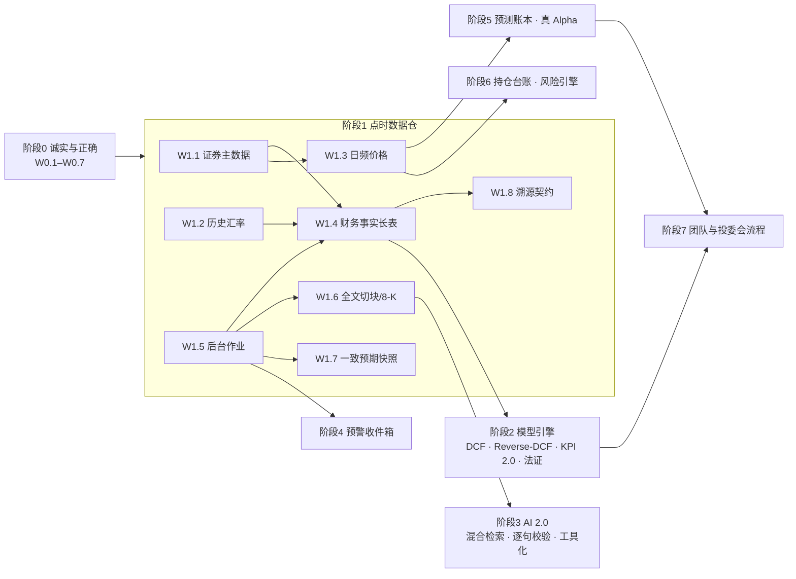

# KANON → 顶级投研系统：全面审查与分阶段实施计划

> 审查日期：2026-11-25 · 基线提交：`57ed443` · 适用对象：负责编码实施的 AI 模型与工程师
> 本文件是「下一阶段做什么、为什么、做到什么程度算完成」的单一真源。每个工作项（Work Item）可独立领取实施；实施前先读 §0。

---

## 0. 实施者必读（违反即返工）

1. **先读宪法**：[AGENTS.md](../AGENTS.md)、[.rules/editorial-craft.md](../.rules/editorial-craft.md)、[.rules/postmortems.md](../.rules/postmortems.md)。所有门禁由 `pnpm check` / `pnpm test` 机械强制：
   - 单文件 `<= 250` 行、单函数 `<= 50` 行、嵌套 `<= 3`、单目录 `<= 12` 个文件（新功能请建子目录）。
   - 金融公式只能写在 `packages/core/src/math/`（纯函数 + Vitest 黄金测试）；共享契约只能写在 `packages/core/src/contracts/`。
   - `@kanon/core/db` 只能被 `apps/web/src/app/**` 引入；客户端 I/O 一律走 `apps/web/src/shared/lib/kanon-fetch.ts` + Zod。
   - 数据库迁移**只增不删**（expand-only），新迁移放 `packages/core/src/db/migrations/v2/`，编号从 `0013` 起；每张新 `pgTable` 会被 `repository.test.ts` 动态反射校验。
   - UI 严守 Swiss Editorial：零装饰文案、语义色/圆角令牌、`@kanon/ui` 唯一组件来源、禁止原生 `<select>`。
2. **一个工作项 = 一次干净提交**：提交信息引用工作项编号（如 `feat(data): D1 security master`）。完成后执行 AGENTS.md §4 的交付闭环（`pnpm format && pnpm check && pnpm test && pnpm build && pnpm test:api` → push → deploy → 验证 `/api/health`）。
3. **不破坏既有 API**：新增字段一律可选；旧 JSONB 结构保留读取兼容；需要替换的旧逻辑先并行运行、对比输出、再切换。
4. **数据诚实高于一切**（见 §2 原则 1）：任何无法从真实数据源得到的数，宁可显示「暂无」也不得推算后冒充真实值。
5. **非目标不变**：不做 K 线盯盘终端、不接券商下单、不做买卖喊单聊天、不做游戏化与社交。本计划所有功能都必须服务于「研究 → 决策 → 复盘」闭环。
6. 每修一个曾出现两次的 bug，按模板追加到 `.rules/postmortems.md` 并尽可能升级为 L1/L2/L3 机械守卫。

---

## 1. 审查结论（Executive Summary）

KANON 的**工程纪律与产品叙事已达一线水准**：分层架构被 depcruise 锁死、AST 守卫覆盖审美/安全/体量、迁移 1:1 反射校验、OCC 并发保护、CSRF 逐 Handler 校验、SSRF 加固的 BYOK、HITL 回写、MCP Server——这些是多数商业投研产品都没有的底座。

但要成为**真正的顶级投研系统**（对标 FactSet/Capital IQ 的数据可信度 + AlphaSense/Hebbia 的原文智能 + Expectations Investing 的方法论严谨度），当前最大的差距不在 UI 或功能数量，而在三件事：

| 差距               | 本质                                                                                                  | 现状证据                                                                                                                           |
| :----------------- | :---------------------------------------------------------------------------------------------------- | :--------------------------------------------------------------------------------------------------------------------------------- |
| **① 数据真实性**   | 若干「机构级」数字其实是启发式推算，标签却暗示为真实数据                                              | 一致预期 = 历史 CAGR × 1.05；「历史估值分位带」= 同业中位数 × 0.65/1.45；汇率为硬编码常量；同业不在图谱时默认 MSFT/NVDA/GOOGL/AMZN |
| **② 方法论严谨度** | 估值、仓位、校准的核心公式存在概念性简化或错误                                                        | Reverse-DCF 的 CAP 年限是经验公式；Kelly 赔率缺省为 4；Brier 分数用「当前价格最接近哪个情景」判定结局；无真正 FCFF-DCF/WACC        |
| **③ 数据基础设施** | 所有财务数据以 per-ticker JSONB 快照存储，无时点（point-in-time）、无日频价格、无分部数据、无后台同步 | `sec_filings_cache` 单行 JSONB；SEC 抓取在请求时同步发生；催化剂日期是自由文本                                                     |

**战略建议**：先用 1 个阶段把「诚实」修好（P0，约 1–2 周），再花 2 个阶段建「点时数据仓 + 严谨模型引擎」（P1–P2），之后 AI、组合、团队能力才有可信的地基。顺序不可颠倒：在不真实的数据上叠加更多 AI，只会更快地产生更自信的错误。

---

## 2. 顶级投研系统的五条设计原则（所有工作项的验收底线）

1. **每个数字可溯源（Provenance-first）**：任何显示的数字都能在 ≤2 次点击内看到：来源（SEC 事实 / 供应商 / 用户输入 / 模型计算）、as-of 时间、原始文件链接、变换公式。推算值必须显式标注「推算」，且不得占用「一致预期」「历史分位」等真实数据的名称。
2. **时点正确（Point-in-time）**：历史分析必须能回答「在 T 日我能知道什么」。财务事实保留 `filed_at` 与重述版本；复盘与校准只使用决策当时的快照。
3. **确定性计算，概率化表达**：数学在 `core/math` 纯函数中确定性计算；不确定性用显式分布/情景表达，而非隐藏的魔法常数。所有常数必须是带名称、带注释、可由用户覆盖的参数。
4. **AI 只做检索、归纳与质询，不做算术与杜撰**：LLM 需要数字时调用确定性工具；每句含数字的断言必须绑定到具体段落 ID，并由校验器逐句验证。
5. **决策可审计、可复盘**：预测在提交时被锁定（不可篡改），到期按事先写明的判定标准结算；决策质量与结果质量分开评估。

---

## 3. 详细审查发现（按严重度）

### 3.1 P0 · 数据真实性问题（必须首先修复）

| #   | 发现                                                                                                               | 位置                                                                                                                  | 影响                                                                   |
| :-- | :----------------------------------------------------------------------------------------------------------------- | :-------------------------------------------------------------------------------------------------------------------- | :--------------------------------------------------------------------- |
| F1  | 「市场一致预期」由 SEC 历史营收 CAGR 推算：`fy1Eps = trailingEps × (1 + revGrowth × 1.05)`，修正趋势按增速阈值判定 | `packages/ai/src/market/consensus-and-peers.ts:28`                                                                    | 用户以为看到的是卖方预期，实际是自己历史的外推；「预期差」分析失去意义 |
| F2  | 「历史与行业估值分位带」并非历史：`p10 = p50 × 0.65`，`p90 = p50 × 1.45`，`p50` 来自同业静态 forwardPe             | `consensus-and-peers.ts:65-87`；UI 标题 `market-benchmarks-card.tsx:55`；PRD §3.2 写作「实时拉取 5 年历史估值分位带」 | 文档与界面均构成误导                                                   |
| F3  | 同业图谱缺失时默认返回 `MSFT/NVDA/GOOGL/AMZN` 作为可比公司                                                         | `consensus-and-peers.ts:20`                                                                                           | 对银行、消费、医疗等标的输出无意义的横评                               |
| F4  | 同业静态参考（增速、毛利、ROIC、forwardPe、EV/FCF）硬编码于源码                                                    | `packages/ai/src/market/peer-catalog.ts`                                                                              | 数据随时间失效且无 as-of                                               |
| F5  | 多币种折算使用硬编码静态汇率（如 `CNY: 0.138`），对 5 年历史统一套用同一汇率                                       | `packages/ai/src/sec/xbrl-helpers.ts:28`                                                                              | 外企 20-F 的历史增速、利润率被汇率噪音污染                             |
| F6  | ADR 比例、CIK 映射硬编码                                                                                           | `xbrl-helpers.ts:43`、`sec/xbrl-period-utils.ts:15`                                                                   | 覆盖面有限，变更（如 ADR 比例调整）无法感知                            |
| F7  | 估值输入非法时静默「自愈」：用 `price / 22` 伪造 EPS、用 17/22/27 倍伪造 PE                                        | `packages/core/src/math/valuation-scenarios.ts:62-75`                                                                 | 用户可能看到并非自己输入的目标价                                       |
| F8  | ROIC 使用固定 21% 税率（`ebit × 0.79`），投入资本未含租赁负债、未区分商誉                                          | `packages/core/src/math/sec-forensics.ts:63`                                                                          | 高税率/低税率公司 ROIC 系统性偏差                                      |

### 3.2 P0 · 方法论错误

| #   | 发现                                                                                                                                                                                               | 位置                                                               | 正确做法                                                                                         |
| :-- | :------------------------------------------------------------------------------------------------------------------------------------------------------------------------------------------------- | :----------------------------------------------------------------- | :----------------------------------------------------------------------------------------------- |
| M1  | Brier 分数：用「当前价格」与「当前（已修订的）三情景目标价」比较，最接近者判为结局。预测未到期即被评分，且使用的是最新概率而非下注时概率                                                           | `packages/core/src/math/institutional/cognitive-calibration.ts:74` | 建立不可篡改的预测账本（见 W5.1），到期按预先锁定的价格区间判定结局                              |
| M2  | Kelly 仓位：`odds = riskRewardRatio ?? 4`（无下行时默认赔率 4），胜率 = (base+bull 概率) × 成熟度系数——把三情景分布压扁成二元赌局                                                                  | `packages/core/src/math/portfolio-analytics.ts:122`                | 对离散三情景直接最大化 `Σ pᵢ·ln(1 + f·rᵢ)`，再乘分数 Kelly 与上限                                |
| M3  | Reverse-DCF 的「竞争优势期 CAP」由 `years + (requiredCagr − 8)/4` 经验公式给出，并非求解所得                                                                                                       | `packages/core/src/math/valuation-advanced.ts:224`                 | 按 Mauboussin 框架：给定 NOPAT 增长、RONIC 与 WACC，求解使 PV = 市值的价值创造年限               |
| M4  | 联动经营模型：Owner FCF = 净利 − 35% × CapEx（`0.35` 为魔法常数，隐含「维护性资本开支 = 35%」）；同一 `terminalMultiple` 同时充当 PE、EV/FCF、EV/EBIT 倍数；`sbcPctOfRev` 驱动项被声明但不参与计算 | `packages/core/src/math/models/operating-model.ts:47`              | 显式 D&A、维护/增长性 CapEx 拆分、营运资本变动、三类倍数各自独立输入；无用驱动项要么接入要么删除 |
| M5  | 估值主引擎仅有 `EPS × PE` 与简化 EV/FCF，缺少 FCFF-DCF、WACC、期权/RSU 稀释（库藏股法）、少数股东权益与租赁调整                                                                                    | `valuation-scenarios.ts`、`valuation-advanced.ts`                  | 见 W2.1                                                                                          |
| M6  | KPI 证伪规则中「毛利率」优先取最新单季、「营收增速」取年度 CAGR，期间口径混用且无法指定                                                                                                            | `packages/core/src/math/models/hypothesis-evaluator.ts:42`         | 规则必须显式声明期间（TTM/FY/单季/YoY）与口径                                                    |
| M7  | 相对 SPY 的 Alpha 只用「决策时价格」与「当前价格」两点，未含股息（非总回报）                                                                                                                       | `cognitive-calibration.ts` `computeBenchmarkAlpha`                 | 用日频复权总回报序列计算（依赖 W1.3）                                                            |

### 3.3 P1 · 数据基础设施缺口

- **无证券主数据（security master）**：`theses` 只有 `ticker` 文本，无交易所、币种、CIK、股票类别、上市状态；同一公司多 ticker（GOOG/GOOGL、BRK.A/B）无法关联。
- **财务数据为 JSONB 快照**：`sec_filings_cache` 一个 ticker 一行，`annuals/quarterlies/facts` 整块存储；无法做跨公司查询、无法时点回放、无法追踪重述。
- **无日频价格历史**：只有 6 个月 sparkline 与即时报价；因此真实估值分位、Beta、波动率、相关性、总回报 Alpha 都无从计算。
- **无分部（segment）与地区数据**：`companyfacts` API 不含维度（dimensions），需解析 XBRL instance 或 Frames API。
- **filings 只取最近 6 份财务文件**（`edgar-client.ts` `pushFilingBucket`），8-K 只取 4 份，且未解析 8-K Item 编号（2.02 业绩、4.01 换审计师、4.02 重述等关键法证信号）。
- **同步发生在请求路径上**：SEC/行情抓取在用户点击时进行，无后台作业、无全局 SEC 限速协调（SEC 公平访问政策为 10 req/s/全体实例）。
- **催化剂日期是自由文本**（`schema.ts:233` `date_label`），靠正则排序；无法生成日历、提醒或 ICS。
- **迁移在运行时冷启动执行**（`db/client.ts`），首个请求承担迁移延迟与并发风险。

### 3.4 P1 · AI 投委会缺口

- 检索仅为 BM25-lite 词法检索（`agent/filing-search-tool.ts:104`），语料仅限已缓存的少量文件；无向量检索、无重排序。
- 数值溯源校验 `isProposalGrounded`（`agent/proposal-grounding.ts`）只检查「数字字符串是否出现在整个语料任意位置」——`20%` 几乎总能命中，无法证明该数字出自所引段落。
- 无离线评测集（eval harness）：无法度量引用准确率、幻觉率、回归。
- 默认模型 ID 已过时（`copilot/run-copilot.ts:66-95`：`claude-sonnet-4-20250514`、`gpt-4.1-mini`、`gemini-2.5-flash`），且硬编码在代码中。
- LLM 无法调用确定性估值工具做 what-if（只能读预先格式化的文本包）。
- BYOK 密钥存于 `localStorage`（`shared/lib/client-provider-storage.ts`）并经请求头逐次发送，而 CSP 为 `script-src 'self' 'unsafe-inline'`、`connect-src 'self' https:`（`apps/web/next.config.ts:23`）——任意 XSS 即可外泄密钥。
- 自主调查 `stopWhen: stepCountIs(4)`，30s 超时后静默回退本地模板，用户难以区分「AI 结论」与「模板结论」的质量差异。

### 3.5 P1 · 组合与复盘缺口

- 仓位以手填百分比 `current_weight_pct` 表达，无股数、无现金、无多币种、无交易批次（lots）；权重不随价格漂移。
- 无组合业绩（TWR/MWR）、无回撤、无事前波动率/风险贡献；压力测试为启发式（同步熊市 / 倍数 -20%），非基于真实收益或因子暴露。
- 因子簇按 ticker 白名单 + 关键词归类（`math/models/factor-clusters.ts`），并非统计意义上的因子暴露。

### 3.6 P2 · 平台与安全

- 无可观测性：无 Sentry / OpenTelemetry / 结构化日志 / 请求 ID。
- 无端到端（Playwright）测试与视觉回归；金融数学无性质测试（property-based）。
- 限流仅按 IP；非 Vercel 环境下 `x-forwarded-for` 可伪造（`api/_lib/request-guards.ts` `extractClientIp`）。
- 密码上限 24 位（NIST 800-63B 建议至少允许 64 位）；无 2FA/Passkey；无 SSO。
- `proxy.ts` 仅匹配 `/`，其余页面依赖各自页面内鉴权（目前正确，但易被新页面遗漏）。
- 单用户模型：`theses.user_id`，无组织/工作区/共享/评论/审批流。
- 全量中文硬编码，无 i18n；国际买方团队无法使用。
- 默认行情源 Yahoo `v8/chart` 为非官方接口，生产环境存在服务条款与稳定性风险。

---

## 4. 目标架构（终态蓝图）

```text
            ┌──────────────── 后台作业层 (jobs: Postgres 队列 + Vercel Cron) ────────────────┐
            │  SEC 同步 · 价格日线 · 汇率 · 一致预期快照 · 文件切块/向量化 · 预警评估 · 预测结算  │
            └───────────────┬─────────────────────────────────────────────────────────────┘
                            ▼
┌──────────────────── 点时数据仓 (Postgres + pgvector) ─────────────────────┐
│ securities · fx_rates_daily · price_bars_daily · corporate_actions          │
│ filings · financial_facts(长表, 含 filed_at/重述/维度) · filing_chunks(向量) │
│ estimates_snapshots · data_provenance                                        │
└───────────────┬────────────────────────────────────────────────────────────┘
                ▼
┌──────────── 确定性引擎 packages/core/src/math ────────────┐   ┌──── AI 层 packages/ai ────┐
│ 标准化报表 · DCF/WACC · 真 Reverse-DCF · 蒙特卡洛 · Kelly │◀──│ 工具调用确定性引擎         │
│ 法证评分卡 · 行业 KPI 模板 · 组合风险 · 校准评分           │   │ 混合检索 + 逐句引用校验     │
└───────────────┬───────────────────────────────────────────┘   │ 离线评测集 · 模型注册表     │
                ▼                                               └───────────────────────────┘
┌──────────── 研究工作流 (apps/web) ────────────┐
│ 五步画布 · 模型网格 · 溯源浮层 · 收件箱预警   │
│ 预测账本 · 投委会审批 · 组合风险 · 团队协作   │
└───────────────────────────────────────────────┘
```

---

## 5. 工作项（Work Items）

> 编号规则：`W<阶段>.<序号>`。优先级：**P0** 立即、**P1** 核心、**P2** 增强。每项标注依赖与可并行性。
> 「文件」一栏给出建议落点，实施者可在不违反分层规则的前提下调整。

### 阶段 0 · 诚实与正确（P0，预计 1–2 周，可多人并行）

#### W0.1 下线伪造的一致预期与估值分位带 · P0

- **问题**：F1、F2、F3。
- **实施**：
  1. `StreetConsensus.source` 增加 `"unavailable"`；当没有已配置的估计数据供应商（FMP/Finnhub estimates 端点）时返回 `unavailable` 且所有字段为 `null`，**删除** `deriveConsensus` 中的推算逻辑（如需保留「基于历史外推」作为对照，改名为 `historicalExtrapolation`，在 UI 中以「历史外推」独立呈现，绝不使用「一致预期」字样）。
  2. `ValuationBand` 在没有日频价格历史（W1.3 前）时返回 `null`；W1.3 完成后由真实历史 PE / EV-FCF 序列计算 p10/p50/p90。同业横评区间单独命名「同业当前倍数区间」。
  3. 删除 `selectPeerTickers` 的 MSFT/NVDA/GOOGL/AMZN 兜底；无图谱时返回空列表并提示用户手动添加可比公司（新增 `thesis_peers` 用户自选同业表，见 W1.6）。
  4. 同步修订 `docs/PRD.md` §3.2「同业与预期」、`README.md` 能力表、`marketing/index.html` 中相关表述。
- **文件**：`packages/ai/src/market/consensus-and-peers.ts`、`packages/core/src/contracts/market-contracts.ts`、`apps/web/src/features/valuation/components/drivers/market-benchmarks-card.tsx`。
- **验收**：
  - 新增测试：无供应商密钥时 `consensus.source === "unavailable"` 且 `fy1Eps === null`；`valuationBand === null`；未知 ticker 的同业列表为空。
  - 全仓 `grep "一致预期"` 的每一处 UI 文案都只在 `source === "live-market"` 分支下出现。
- **依赖**：无。

#### W0.2 取消估值输入的静默自愈 · P0

- **问题**：F7。
- **实施**：`sanitizeValuationInput` 改为返回 `{ ok: true, input } | { ok: false, issues: ValuationInputIssue[] }`；调用方（组合分析、校准、导出）对非法输入跳过计算并显示「估值输入待完善」，不再伪造 EPS/PE。保留仅针对展示层的数值夹取（clamp）但必须在 UI 标注。
- **文件**：`packages/core/src/math/valuation-scenarios.ts` 及全部调用点（`grep -rn sanitizeValuationInput`）。
- **验收**：黄金测试覆盖 EPS ≤ 0、PE 超限、概率不归一三类；对应 UI 状态有截图级手测。

#### W0.3 修正 Kelly 仓位为离散分布对数效用最优 · P0

- **问题**：M2。
- **实施**：新增 `packages/core/src/math/sizing/kelly-discrete.ts`：
  - 输入：三情景 `{ probability, returnPct }`（来自 `ValuationScenarioSummary`），`fraction`（默认 0.5），`capPct`。
  - 求解 `f* = argmax_{f∈[0,1]} Σ pᵢ·ln(1 + f·rᵢ)`（单变量凹函数，用黄金分割或牛顿法，≤ 60 次迭代）；任一 `rᵢ ≤ -100%` 时 f 上界收紧为使 `1 + f·rᵢ > 0`。
  - 输出：`fullKellyPct`、`fractionalKellyPct`、`cappedPct`、`expectedLogGrowth`、`probabilityOfLoss`。
  - 「预警假设折半」「成熟度折扣」保留为**显式、可见、可关闭**的调整项，逐项列出。
- **替换**：`suggestKellyCappedWeight` 内部改用新函数，删除 `?? 4` 缺省赔率。
- **验收**：黄金测试——(a) 二元对称赌局与闭式解 `p − q/b` 一致（误差 < 1e-6）；(b) 全部情景正收益时 f* = 1 并被上限截断；(c) 期望收益 ≤ 0 时 f* = 0。

#### W0.4 修正 ROIC 与法证口径 · P0

- **问题**：F8。
- **实施**：ROIC 使用实际有效税率 `IncomeTaxExpenseBenefit / IncomeLossBeforeIncomeTaxes`（夹取 0–40%，缺失时回退 21% 并在溯源中标注「法定税率回退」）；投入资本 = 股东权益 + 有息负债 + 经营租赁负债（`OperatingLeaseLiability`）− 超额现金（现金 − 2% 营收），并另给出「含/不含商誉」两版。
- **文件**：`packages/core/src/math/sec-forensics.ts`、`sec-forensics-metrics.ts`、`packages/ai/src/sec/edgar-annuals.ts`（新增税前利润、所得税、租赁负债、商誉标签抽取）。
- **验收**：对 3 家已知公司（如 MSFT、COST、TSM）用手工计算的 FY 数据做黄金测试，误差 < 0.5pp。

#### W0.5 修正联动经营模型的隐藏常数 · P0

- **问题**：M4。
- **实施**：`OperatingCaseDrivers` 新增可选 `daPctOfRev`、`maintenanceCapexPctOfRev`、`nwcPctOfIncrementalRev`、`peMultiple`、`evFcfMultiple`、`evEbitMultiple`（缺省时由旧 `terminalMultiple` 推导，保证旧数据兼容）。Owner FCF = NOPAT + D&A − 维护性 CapEx − ΔNWC（增长性 CapEx 单列展示）。`sbcPctOfRev` 要么用于「SBC 作为现金成本」的可选口径开关，要么从 UI 删除。删除 `0.35` 常数。
- **验收**：旧草稿加载后输出与修改前在 ±1% 内一致（兼容测试）；新增驱动项的边界测试。

#### W0.6 Brier 分数临时止血 · P0

- **问题**：M1（彻底修复在 W5.1）。
- **实施**：在预测账本上线前，`brierScore` 一律返回 `null` 并在 UI 显示「待预测到期」；校准总分去掉 Brier 加分项。不要保留当前的错误算法。
- **验收**：测试断言当前无到期预测时 `brierScore === null`。

#### W0.7 文档与官网口径对齐 · P0

- 逐条核对 `README.md`、`docs/PRD.md`、`marketing/index.html` 中「实时」「一致预期」「5 年历史分位」「Brier」等措辞，与 W0.1–W0.6 后的真实能力保持一致。增加 `.rules/postmortems.md` 条目：「禁止以真实数据名称展示推算值」，并在 `scripts/garden-guards.mjs` 加守卫：`features/**` 中出现「一致预期」文案的组件必须引用 `source` 判定（可用 AST 粗检）。

---

### 阶段 1 · 点时数据仓（P1，预计 4–6 周，是后续一切的地基）

#### W1.1 证券主数据 `securities` · P1

- **表**：`securities(id, ticker, exchange_mic, cik, name, share_class, currency, country, adr_ratio, adr_ratio_source, sector_code, industry_code, is_active, listed_at, delisted_at, updated_at)`；唯一键 `(ticker, exchange_mic)`。
- **数据源**：SEC `company_tickers_exchange.json`（含交易所）每日同步；ADR 比例来自用户覆盖或 20-F 文本解析，标注来源。
- **迁移**：`theses` 增加可空 `security_id`，后台回填；旧 `ticker` 列保留。
- **替换**：`KNOWN_CIK_MAP` 与 `ADR_RATIO_BY_TICKER` 降级为种子数据。
- **验收**：GOOG/GOOGL 关联同一 CIK；退市标的标注 `is_active=false`。

#### W1.2 历史汇率 `fx_rates_daily` · P1

- **表**：`fx_rates_daily(currency, rate_date, usd_per_unit, source)`，主键 `(currency, rate_date)`。
- **数据源**：ECB 参考汇率（免费、权威，每日）或美联储 H.10；后台作业每日增量。
- **口径**：损益/现金流科目使用**期间平均汇率**；资产负债表科目使用**期末汇率**；同时保留本币原值，UI 可切换「本币 / 美元」。
- **替换**：`FX_TO_USD` 常量仅作为离线兜底并在溯源中标注「静态汇率兜底」。
- **验收**：对一家 20-F 公司（如 TSM），5 年营收美元化结果与按期间均值汇率手算一致（误差 < 0.3%）。

#### W1.3 日频价格与公司行动 `price_bars_daily` / `corporate_actions` · P1

- **表**：`price_bars_daily(security_id, bar_date, open, high, low, close, adj_close, volume, source)`；`corporate_actions(security_id, ex_date, kind: split|dividend|spinoff, ratio, amount, currency)`。
- **数据源**：行情供应商抽象（`packages/ai/src/market/provider-registry.ts`）扩展 `fetchDailyBars(ticker, from, to)`；默认免费源仅用于开发，生产推荐付费源（Polygon/FMP/Tiingo）。至少回填 10 年。
- **解锁**：真实历史 PE/EV-FCF 分位带（W0.1 后续）、Beta、波动率、相关矩阵、总回报 Alpha（M7）、回撤。
- **验收**：拆股前后复权价连续；SPY 总回报与公开数据误差 < 0.1%/年。

#### W1.4 规范化财务事实长表 `financial_facts` · P1（核心）

- **表**：

  ```text
  filings(accession PK, security_id, cik, form, filed_at, period_end, fiscal_year, fiscal_period,
          items text[] /* 8-K items */, primary_doc_url, amends_accession, parse_status)
  financial_facts(id PK, security_id, accession FK, concept /* 规范科目 */, xbrl_tag, taxonomy,
                  period_start, period_end, duration: instant|quarter|ytd|annual,
                  fiscal_year, fiscal_period, value numeric(28,6), unit, currency,
                  dimensions jsonb /* 分部/地区，默认 {} */, filed_at, is_latest_for_period bool)
  ```

  索引：`(security_id, concept, period_end, filed_at)`。
- **概念映射**：新增 `packages/core/src/contracts/financial-concepts.ts`，定义约 80 个规范科目（营收、毛利、EBIT、D&A、SBC、CapEx、OCF、有息负债、租赁负债、商誉、税前利润、所得税、稀释股本……）到 us-gaap / ifrs-full 标签的有序候选列表（迁移现有 `edgar-annuals.ts` 中的标签逻辑并补全）。
- **时点查询**：`getFactsAsOf(securityId, concepts, asOfDate)` 只返回 `filed_at <= asOfDate` 的最新版本；默认视图使用 `is_latest_for_period`（即重述后口径）。
- **重述检测**：同一 `(concept, period)` 出现多个 `filed_at` 且数值差 > 0.5% 时生成法证信号「数值重述」。
- **Q4 推导**：`FY − 9M YTD` 逻辑迁移为对长表的纯函数，带溯源标注「推导值」。
- **兼容**：保留 `sec_filings_cache` 作为物化视图式缓存，由长表生成，前端暂不改动。
- **验收**：
  - 黄金集：选 30 家覆盖面广的发行人（大型科技、银行、保险、REIT、能源、零售、20-F 外企、52/53 周财年、发生过拆股/重述的公司），录入 3 个财年的关键科目手工核对值，自动化测试准确率 ≥ 99.5%。
  - 时点测试：某公司重述前后 `getFactsAsOf` 返回不同值。

#### W1.5 后台作业与全局 SEC 限速 · P1

- **表**：`jobs(id, kind, payload jsonb, run_at, attempts, max_attempts, locked_by, locked_until, last_error, status, created_at)`。
- **执行**：Vercel Cron 每分钟调用 `/api/internal/jobs/tick`（用 `CRON_SECRET` 鉴权、不走 CSRF 规则但需在 `api-security-guards.mjs` 白名单中显式声明），以 `FOR UPDATE SKIP LOCKED` 领取作业，单次时间预算 < 50s。
- **作业类型**：`sec_sync(security)`、`filing_parse(accession)`、`filing_embed(accession)`、`price_backfill`、`fx_daily`、`estimates_snapshot`、`alerts_evaluate`、`forecast_resolve`。
- **限速**：SEC 请求通过 Postgres 令牌桶（复用 `rate_limit_buckets`）全局 ≤ 8 req/s。
- **用户路径**：`GET /api/sec/[ticker]` 只读库；缺失时入队并返回 `202 + 进度`，前端轮询或 SSE 订阅。
- **迁移执行**：生产迁移移至部署步骤（新增 `pnpm db:migrate`，在 Vercel build 前或 CI 中执行），运行时迁移仅保留给 PGlite 本地模式。
- **验收**：冷启动不再执行 DDL；断网/429 时作业指数退避重试；`/api/health` 增加作业积压指标。

#### W1.6 文件全文、切块与 8-K 解析 · P1

- **范围**：每家公司回填近 5 年 10-K/10-Q/20-F/6-K/8-K（含 EX-99.1 业绩新闻稿）与 DEF 14A。
- **表**：`filing_chunks(id PK /* accession#section#para */, accession, section_code /* 1, 1A, 7, 7A, 8 … */, para_index, text, tsv tsvector, embedding vector(1024) null, char_start, char_end)`。
- **解析**：复用 `sec/filing-text-parser.ts`，补全标准 Item 识别；8-K 解析 Item 编号并对 2.02/4.01/4.02/5.02 生成结构化事件。
- **同业**：新增 `thesis_peers(thesis_id, security_id, role: peer|customer|supplier|competitor, added_by)`，取代硬编码 `PEER_GRAPH`；可由 10-K「竞争」段落抽取建议，用户确认后写入。
- **验收**：段落 ID 稳定（重复解析结果一致）；8-K 4.02 能触发法证红旗。

#### W1.7 一致预期快照（真实数据） · P1

- **表**：`estimates_snapshots(security_id, provider, metric: revenue|eps|ebit|fcf, fiscal_period, mean, median, high, low, analyst_count, as_of)`。
- **作业**：每周快照一次，从而得到**真实的预期修正趋势**（4 周/12 周修正幅度），替代 F1 的阈值判定。
- **验收**：无供应商时整块隐藏；修正趋势由两次快照差值计算并有测试。

#### W1.8 数据溯源契约 `Provenance` · P1

- **契约**：`packages/core/src/contracts/provenance.ts`

  ```ts
  type Provenance =
    | { kind: "sec_fact"; accession: string; concept: string; xbrlTag: string; filedAt: string; url: string }
    | { kind: "derived"; formula: string; inputs: Provenance[] }
    | { kind: "vendor"; provider: string; asOf: string }
    | { kind: "user_input"; userId: string; editedAt: string }
    | { kind: "fallback"; reason: string };
  ```
- 所有面向 UI 的数值 DTO 逐步改为 `{ value: number | null; provenance: Provenance; asOf: string }`（新字段，旧字段保留）。
- **UI**：`@kanon/ui` 新增 `ProvenancePopover`（悬停数字显示来源、时间、公式、原文链接），遵循 editorial-craft（不新增装饰文案，细下划线提示）。
- **守卫**：新增 AST 守卫，`features/**/sec-*` 与 `valuation/**` 中直接渲染裸 `number` 的财务字段给出警告（先 warn，稳定后升为 error）。
- **验收**：Step 3 法证表与 Step 4 驱动卡的每个数字都可查看来源。

---

### 阶段 2 · 严谨模型引擎（P1，预计 4–5 周，可与阶段 1 后半并行）

#### W2.1 FCFF-DCF 与 WACC 引擎 · P1

- **文件**：`packages/core/src/math/dcf/`（`wacc.ts`、`fcff-dcf.ts`、`equity-bridge.ts`、`dilution.ts`、`index.ts`）。
- **能力**：
  - 显式预测期 5–10 年 + 衰减期（增速/ROIC 线性收敛至终值假设）+ 终值（Gordon 增长或退出倍数，二选一并交叉显示另一种的隐含值）。
  - WACC = E/V·(rf + β·ERP + 规模/国家溢价) + D/V·rd·(1 − t)；所有参数显式输入，β 可由 W1.3 回归得到。
  - 年中折现约定开关；SBC 作为费用/作为稀释两种口径开关。
  - 股权桥：EV − 有息负债 − 租赁负债 − 少数股东权益 − 优先股 + 现金 + 非经营资产。
  - 稀释：库藏股法处理期权、RSU 全额计入、可转债 if-converted。
- **一致性**：三情景结构保留，每个情景是一套 DCF 驱动。
- **验收**：与教科书案例（Damodaran 公开估值表或 McKinsey Valuation 示例）复算误差 < 0.5%；性质测试：WACC↑ → 价值↓，终值增速 ≥ WACC 时报错。

#### W2.2 真 Reverse-DCF（Expectations Investing） · P1

- **替换**：`calculateTrueReverseDcf` 中的 `impliedCapYears` 经验公式（M3）。
- **算法**：给定当前 EV、基期 NOPAT、WACC、RONIC 与增长假设，二维求解「隐含销售增速 × 隐含营业利润率」等值曲线，以及在固定增速下使 `PV(价值创造期 FCF) + NOPAT_T / WACC = EV` 的隐含 CAP 年限（整数搜索 + 插值）。
- **输出**：隐含 CAP、隐含增速、隐含利润率、与历史/管理层指引/一致预期的对照（来源分别标注）。
- **验收**：Mauboussin & Rappaport《Expectations Investing》书中示例复算；单调性测试。

#### W2.3 概率分布估值（蒙特卡洛） · P2

- **文件**：`packages/core/src/math/simulation/`（可复现的种子随机数生成器，如 `mulberry32`；禁止 `Math.random`）。
- 驱动项分布：三角/截尾正态（营收 CAGR、利润率、退出倍数），可设相关系数（Cholesky）。
- 输出：目标价分布分位、IRR 分布、P(亏损)、P(IRR > 门槛)、CVaR 5%；与三情景结果并列展示。
- **性能**：10,000 次模拟 < 150ms（Web Worker 执行，避免阻塞主线程）。
- **验收**：固定种子结果可复现；退化分布（方差 0）结果等于确定性模型。

#### W2.4 模型版本与单元格级溯源 · P1

- **表**：`model_versions(id, thesis_id, kind: scenarios|dcf|operating|sotp, inputs jsonb, outputs jsonb, input_provenance jsonb, created_by, created_at, label)`，只追加。
- 每次显式保存（`⌘S` 或离开步骤）生成版本；与 `thesis_revisions` 关联。Revision Diff 视图可对比任意两版模型的输入与输出差异。
- **验收**：可还原任一历史版本的目标价；重算结果与当时保存的输出一致（引擎版本号写入 `outputs`，引擎升级时提示「使用旧引擎计算」）。

#### W2.5 行业化 KPI 模板与证伪规则 2.0 · P1

- **模板**：SaaS（ARR、NRR、RPO、Rule of 40、CAC 回收期）、半导体（库存天数、Book-to-Bill、毛利率周期）、零售（同店、坪效、存货周转）、银行（NIM、CET1、拨备覆盖率、贷存比）、保险（综合成本率、准备金发展）、REIT（FFO/AFFO、出租率）、能源（单位成本、储量替代率）。
- **规则 2.0**：`HypothesisKpiRule` 增加 `period: "ttm" | "fy" | "quarter" | "yoy"`、`concept`（任意规范科目或公式表达式，如 `grossProfit / revenue`）、`segment`（可选维度）、`consecutivePeriods`（连续 N 期才判定）。表达式由受限的安全解析器求值（禁止 `eval`）。
- **验收**：旧 6 种规则自动迁移且判定结果不变；每个模板至少 1 个端到端黄金测试。

#### W2.6 法证评分卡扩展 · P1

- 新增：Beneish M-Score、Altman Z（非金融）、Piotroski F-Score、DuPont 三因子、应收/存货增速与营收增速背离、资本化软件/研发、商誉占比与减值、非 GAAP 调整幅度（从 EX-99.1 抽取）、审计师变更与重述（8-K 4.01/4.02）、迟报（NT 10-K）、客户集中度（从 10-K 文本抽取并引用段落）。
- 金融/REIT 自动切换适用指标集，不对银行计算 Altman Z。
- **验收**：每项指标有公式文档（写入代码注释或 `docs/`）与黄金测试；已知会计问题案例（选历史公开案例）能被触发红旗。

---

### 阶段 3 · 原文智能与 AI 投委会 2.0（P1，依赖 W1.6）

#### W3.1 混合检索 · P1

- Postgres `tsvector`（或保留 BM25-lite）+ `pgvector` 余弦相似度，RRF（Reciprocal Rank Fusion）融合；可选重排序模型。
- 嵌入模型通过模型注册表配置（W3.4）；PGlite 本地模式需验证 `vector` 扩展可用，不可用时降级为纯词法并在 UI 标注。
- 引用格式统一为 chunk ID；前端可深链至 SEC 原文并用 `#:~:text=` 文本片段高亮。
- **验收**：构建 100 条「问题 → 期望段落」检索评测集，Recall@5 ≥ 0.85。

#### W3.2 逐句引用校验器 · P1（替换 `isProposalGrounded`）

- LLM 输出结构改为 `claims: { text, citations: chunkId[] }[]`。
- 校验三层：(1) 引用的 chunk 存在且属于本标的；(2) 句中每个数字（含单位归一：B/M/亿/%/bps）出现在**被引用的 chunk** 或确定性工具输出中，而非整个语料；(3) 可选 LLM-judge 蕴含校验（低成本模型，判定 supported/partial/unsupported）。
- 未通过的句子在 UI 中以「未验证」状态显示且不能一键回写。
- **验收**：在评测集上，人工标注的伪造数字 100% 被拦截；误杀率 < 5%。

#### W3.3 让 LLM 调用确定性引擎 · P1

- 新增工具：`run_valuation_what_if(changes)`、`get_facts(concepts, periods)`、`compare_periods(concept)`、`evaluate_kpi_rule(rule)`、`search_filings(query, sections, years)`。工具实现只调用 `@kanon/core/math` 与数据仓，返回结构化 JSON。
- 系统提示禁止模型自行做算术；所有数字须来自工具返回。
- **验收**：评测题「若毛利率下降 300bps，中性目标价变化多少」答案与引擎计算完全一致。

#### W3.4 模型注册表与成本计量 · P1

- `packages/ai/src/models/registry.ts`：按用途（`synthesis`、`investigation`、`judge`、`embedding`）配置提供商与模型 ID，环境变量覆盖；移除散落在 `run-copilot.ts` 的过时默认 ID，默认值更新为各家当前主力模型（实施时查询官方文档确认最新 ID）。
- `ai_usage(user_id, run_id, purpose, provider, model, input_tokens, output_tokens, cost_usd, created_at)` 记录用量；设置页展示月度用量。
- **验收**：切换模型无需改代码；每次 Agent 运行有用量记录。

#### W3.5 离线评测框架 · P1

- `packages/ai/evals/`：固定的录制夹具（filings + 期望答案 + 期望引用），指标：引用精确率、数字幻觉率、检索 Recall@k、结论与人工标注一致率、延迟、成本。
- `pnpm eval`（不进入默认 `pnpm test`，避免 CI 消耗外部额度；提供 `--offline` 回放模式进入 CI）。
- 包含提示注入用例：在 filing 文本中植入「忽略以上指令……」，断言模型输出不受影响。
- **验收**：每次修改 Agent 提示或工具时附带评测结果对比。

#### W3.6 BYOK 密钥安全 · P1

- 方案 A（推荐）：服务端加密存储——`user_ai_credentials(user_id, provider, ciphertext, iv, key_version, created_at)`，AES-256-GCM 信封加密，主密钥来自环境变量/KMS；前端不再持有明文。
- 方案 B（若坚持本地）：仅存 `sessionStorage`，并收紧 CSP：基于 nonce 的 `script-src`（移除 `'unsafe-inline'`），`connect-src` 限定为 `'self'`（所有外部调用走服务端代理）。
- 两种方案都必须收紧 CSP。
- **验收**：安全测试——注入的内联脚本无法读取密钥；CSP 报告无违规。

#### W3.7 文件对比与语言变化监测 · P2

- 对同一公司相邻年度 10-K 的 Item 1A（风险因素）、Item 7（MD&A）做段落级 redline（新增/删除/修改），扩展现有 `filing-diff-box.tsx`。
- 检测关键措辞变化（如「material weakness」「going concern」「substantial doubt」首次出现）并生成法证信号。

---

### 阶段 4 · 监控、预警与研究收件箱（P1，依赖 W1.5）

#### W4.1 预警规则与收件箱 · P1

- **表**：`alert_rules(id, user_id, thesis_id, kind, params jsonb, enabled)`、`inbox_items(id, user_id, thesis_id, kind, title, body, payload jsonb, created_at, read_at, dismissed_at)`。
- **规则类型**：新财报发布（并自动重算 KPI 规则，输出「强化/削弱」）、8-K 关键 Item、Form 4 集群买入/卖出、价格进入门槛买点（15%/20% IRR）、价格跌破熊市目标价（论点可能失效）、催化剂 7 天内到期、论点超过 N 天未复盘、一致预期修正超阈值。
- **UI**：驾驶舱顶栏收件箱入口（遵循「顶栏减法」，仅在有未读时显示计数）；条目直达对应画布步骤。
- **验收**：模拟一份新 10-Q 入库 → 5 分钟内生成收件箱条目并给出 KPI 重新判定。

#### W4.2 催化剂结构化日期 · P1

- **迁移**：`thesis_catalysts` 增加可空 `event_date date`、`date_precision: day|month|quarter|fiscal_quarter`、`fiscal_calendar_ref`；后台用 `parseCatalystSortKey` 回填，无法解析的保留原文并提示用户补全。
- 新增 ICS 订阅：`GET /api/calendar/[token].ics`（只读个人令牌）。
- 财报日自动预填（来自供应商或基于历史申报节奏推断，推断值标注「预计」）。
- **验收**：日历视图按真实日期排序；ICS 可被 Apple/Google 日历订阅。

---

### 阶段 5 · 预测账本与真校准（P1，依赖 W1.3）

#### W5.1 不可篡改的预测账本 · P1（修复 M1）

- **表**：`forecasts(id, thesis_id, user_id, kind: price_scenarios|kpi|binary_event, statement, probability numeric, scenario_bands jsonb /* 提交时锁定的熊/中/牛价格区间与概率 */, resolution_criteria text, resolve_by date, created_at, locked_hash, resolved_at, outcome jsonb, score jsonb)`。行写入后仅允许更新 `resolved_at/outcome/score`（应用层 + 数据库触发器双重保证）。`locked_hash` = 内容 SHA-256。
- **生成**：Step 4 显式保存三情景、Step 2 新增可证伪假设、Step 5 记录交易时，提示用户将其登记为预测（一键，默认勾选）。
- **结算**：`forecast_resolve` 作业到期后按 `resolution_criteria` 自动判定（价格类用 W1.3 数据、KPI 类用 W1.4 数据），无法自动判定的进入收件箱请用户裁决。
- **评分**：多类别 Brier、对数损失；Murphy 分解（可靠性、分辨率、不确定性）；校准曲线（按概率分桶的预测 vs 实际频率）。
- **验收**：黄金测试覆盖完美校准、过度自信、始终 50% 三种合成样本的分解结果。

#### W5.2 决策质量 vs 结果质量 · P2

- 每笔决策记录：当时的论点版本、模型版本、情绪、离场条件、预期 IRR。复盘时分别打分「过程是否遵守纪律」与「结果」，生成 2×2 矩阵（好过程好结果 / 好过程坏结果……）。
- 与零杠杆硬闸门一致：纪律违规（无离场条件、超上限）单列。

#### W5.3 真实 Alpha 与归因 · P1（修复 M7）

- 使用复权总回报序列，按每笔交易日期计算相对 SPY（及用户可选的行业 ETF 基准）的超额收益；组合层面计算 TWR 与 MWR（IRR）。
- 归因：选股 vs 仓位（Brinson 简化版，以行业为维度）。

---

### 阶段 6 · 组合与风险（P1，依赖 W1.3）

#### W6.1 持仓台账（股数、现金、多币种） · P1

- **表**：`portfolio_accounts(id, user_id, base_currency, name)`、`transactions(id, account_id, security_id, trade_date, side: buy|sell|dividend|deposit|withdraw|fee, quantity numeric, price numeric, currency, fx_rate, fees, note, discipline_entry_id)`、`lots`（FIFO/平均成本可选）。
- 当前权重 = 市值 / 账户净值，随价格自动漂移；旧 `current_weight_pct` 作为「无台账模式」保留。
- **零杠杆硬约束**：现金余额不得为负、禁止卖空（数量不得为负），后端拒绝并返回 400；与现有 `noLeverageConfirmed` 规则并存。
- CSV 导入（券商对账单通用格式），**不接入任何券商交易接口**（非目标）。
- **验收**：交易回放后的持仓与成本与手工计算一致；拆股后数量与成本自动调整。

#### W6.2 组合风险引擎 · P1

- **文件**：`packages/core/src/math/risk/`（`covariance.ts`：Ledoit-Wolf 收缩协方差；`risk-contrib.ts`；`drawdown.ts`；`factor-regression.ts`）。
- 输出：事前年化波动、各持仓边际风险贡献、Beta、最大回撤、相关性热力图、流动性（以 20 日 ADV 计的清仓天数）。
- 因子暴露：用 Fama-French 五因子 + 动量（Kenneth French Data Library，实施时确认使用条款）做滚动回归，替代 ticker 白名单因子簇（保留为「主题标签」）。
- 历史情景压力测试：用真实收益重放 2020-02/03、2022 加息、2008 等窗口。
- **验收**：与 numpy/pandas 参考实现（在测试夹具中给出预计算结果）误差 < 1e-6。

#### W6.3 约束感知的仓位建议 · P2

- 在 W0.3 离散 Kelly 基础上，叠加组合约束：单票上限、行业上限、总权益 ≤ 100%（零杠杆）、相关性惩罚（多资产 Kelly 的保守近似：`f = λ·Σ⁻¹·μ`，λ 为分数系数，强制非负与上限）。
- 只给「建议区间 + 理由」，不生成交易指令。

---

### 阶段 7 · 团队与机构级能力（P2，预计 4–6 周）

#### W7.1 组织、工作区与权限 · P2

- **表**：`organizations`、`memberships(org_id, user_id, role: owner|pm|analyst|viewer)`、`theses.org_id`（可空，个人模式为空）。
- Postgres 行级安全（RLS）作为纵深防御：会话内 `SET app.user_id`，策略按 org/membership 校验。应用层仍保留现有 `userId` 过滤。
- **验收**：跨组织访问在 RLS 层被拒（直接 SQL 测试）。

#### W7.2 评审与投委会流程 · P2

- 备忘录状态机：`draft → in_review → ic_scheduled → approved | rejected | revise`；行内锚定评论（锚定到段落或模型单元格）；投票与签批记录写入审计日志，签批后论点与模型版本锁定为「IC 批准版本」。
- 「IC 会议模式」：全屏只读呈现一页纸备忘录 + 关键数字溯源 + 反向质询清单。

#### W7.3 审计日志与合规 · P2

- `audit_log(id, org_id, actor_id, action, entity, entity_id, before jsonb, after jsonb, ip, user_agent, created_at)`，只追加（触发器禁止 UPDATE/DELETE）。
- 限制名单（restricted list）与个人交易预审备注（仅记录，不执行交易）。

#### W7.4 身份安全 · P1（安全项提前）

- TOTP 两步验证与 Passkey（WebAuthn）；OIDC SSO（Google Workspace / Microsoft Entra）供团队版使用。
- 密码上限放宽至 64 位（同步修改 `auth-contracts.ts` 单一真源与 `PASSWORD_MAX_LENGTH`，更新 editorial-craft §3 文档）；登录失败按账号维度递增延迟/锁定。
- 限流增加用户维度键；仅在可信代理（Vercel）下信任 `x-forwarded-for`，否则使用连接 IP。
- `proxy.ts` 改为默认拦截所有页面路由（白名单 `/login`、`/register`、静态资源），避免新页面遗漏鉴权。

---

### 阶段 8 · 工程平台（P1/P2，与各阶段并行）

#### W8.1 可观测性 · P1

- Sentry（前后端错误）+ `@vercel/otel`（追踪）+ 结构化 JSON 日志（含 `requestId`、`userId` 哈希、路由、耗时）；`jsonError` 统一附带 `requestId` 便于用户反馈。
- 关键 SLO：API P95 < 300ms（不含 AI）、SEC 同步作业成功率 ≥ 99%、Agent 运行成功率 ≥ 97%。

#### W8.2 测试体系补全 · P1

- **端到端**：Playwright 覆盖 6 条关键旅程（注册登录 → 新建标的 → 五步填写 → Agent 运行与回写 → 记录交易 → 季度复盘与导出），在 CI 中针对 `pnpm build` 产物运行。
- **性质测试**：`fast-check` 覆盖估值单调性（EPS↑→目标价↑）、概率归一、Kelly 边界、DCF 对 WACC 单调、汇率折算可逆。
- **黄金财报夹具**：W1.4 的 30 家发行人 `companyfacts` 原始 JSON 存入 `packages/ai/src/sec/__fixtures__/`（注意体积，可压缩或裁剪到所需标签）。
- **视觉回归**：Playwright 截图对比（亮/暗主题 × 关键页面），守护 editorial-craft。

#### W8.3 性能与规模 · P2

- 驾驶舱改用轻量投影（已有 `listThesisSummaries` 思路），`listTheses` 全量 `ThesisDetail` 仅在需要时加载；支持 500+ 标的不退化（首屏 < 1.5s）。
- 数据仓查询加覆盖索引；重计算（蒙特卡洛、风险矩阵）放入 Web Worker 或服务端缓存。

#### W8.4 国际化 · P2

- 抽取 UI 字符串到 `zh-CN` / `en-US` 字典（建议 `next-intl`），金额/日期/数字按 locale 格式化；导出与 AI 提示词支持双语。守卫：`features/**` 中禁止新增未进入字典的中文字面量（渐进式启用）。

#### W8.5 数据许可与供应商合规 · P1

- 在设置页与文档明示各数据源许可；生产默认使用有商业授权的行情源，Yahoo 非官方接口仅用于本地开发或显式选择，并在 UI 标注「非授权数据源」。
- SEC 请求遵守公平访问政策（UA 含联系邮箱——已实现于 `sec-http.ts`，需确认生产环境变量已配置）。

---

## 6. 依赖关系与并行编排



**可立即并行的独立工作项**（互不改动同一文件）：W0.1、W0.2、W0.3、W0.4、W0.5、W0.6、W8.1、W8.2（E2E 部分）、W7.4。
**串行瓶颈**：W1.5 → W1.4 → W1.8，这三项建议由同一实施者连续完成。

---

## 7. 「顶级」的量化验收标准（Definition of Top-Tier）

| 维度     | 指标                                       | 目标                    |
| :------- | :----------------------------------------- | :---------------------- |
| 数据准确 | 黄金集 30 家 × 3 年 × 关键科目匹配率       | ≥ 99.5%                 |
| 数据溯源 | Step 3/4 显示数字中带可查看溯源的比例      | 100%                    |
| 数据时效 | 新 10-K/10-Q 发布到入库与 KPI 重算         | ≤ 30 分钟               |
| 方法论   | 估值/仓位/校准公式均有公开教材级复算测试   | 100% 覆盖               |
| AI 可信  | 评测集数字幻觉拦截率 / 引用精确率          | 100% / ≥ 95%            |
| AI 检索  | 检索评测 Recall@5                          | ≥ 0.85                  |
| 校准     | 预测到期自动结算率                         | ≥ 90%（其余进入收件箱） |
| 性能     | 驾驶舱首屏（200 标的）/ 步骤切换           | < 1.5s / < 100ms        |
| 可靠性   | 后台作业成功率 / API P95                   | ≥ 99% / < 300ms         |
| 安全     | 2FA 可用、CSP 无 `unsafe-inline`、RLS 生效 | 全部达成                |

---

## 8. 推荐实施顺序（里程碑）

| 里程碑                           | 内容                                 | 对用户的可感知价值                                                 |
| :------------------------------- | :----------------------------------- | :----------------------------------------------------------------- |
| **M1 · 诚实版**（第 1–2 周）     | 阶段 0 全部 + W8.1 + W7.4            | 每个数字都不再「装作真实」；仓位与 ROIC 计算正确；账号更安全       |
| **M2 · 数据地基**（第 3–8 周）   | W1.1–W1.5、W1.8、W8.2                | 外企财报汇率正确；数据后台自动更新；数字可点开查看来源             |
| **M3 · 机构模型**（第 6–11 周）  | W1.3、W2.1、W2.2、W2.4、W2.5、W2.6   | 真 DCF/WACC、真 Reverse-DCF、行业 KPI 模板、真实历史估值分位       |
| **M4 · 原文智能**（第 9–14 周）  | W1.6、W1.7、W3.1–W3.6                | AI 每句话都能点回原文段落；可做 what-if；真实一致预期              |
| **M5 · 纪律闭环**（第 12–16 周） | 阶段 4、阶段 5、W6.1、W6.2           | 财报发布自动提醒并重判假设；预测到期自动结算的真校准；真实组合风险 |
| **M6 · 团队版**（第 16 周起）    | 阶段 7、W8.3、W8.4、W2.3、W3.7、W6.3 | 多人协作、投委会审批、审计日志、英文界面                           |

---

## 9. 明确不做（防止范围蔓延）

- 不做盘中实时推送、K 线技术指标、Level 2 行情。
- 不接券商下单、不生成交易指令；仓位建议只输出区间与理由。
- 不做「AI 直接给出买/卖/目标价」的对话入口；AI 产出必须进入人机共审流程。
- 不做排行榜、连击、徽章、社区动态。
- 不为追求功能数量牺牲 editorial-craft：每个新模块都要回答「删掉它用户的研究质量会下降吗？」
